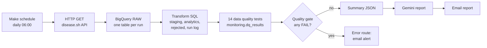

# Pipeline Design Document

**Project:** Automated COVID-19 data pipeline (no-code orchestration, BigQuery warehouse)
**Author:** Gideon
**Purpose:** Portfolio project

## 1. Goal

Extract country-level COVID-19 statistics from a public API, load them into a data warehouse, transform and validate them, test data quality automatically after every run, alert on failures, and generate a short AI-written quality report. Orchestration is done with a no-code tool.

## 2. Architecture

| Component | Technology | Role |
|---|---|---|
| Source | disease.sh `/v3/covid-19/countries` | About 231 country records per call (~134 KB JSON), no API key |
| Orchestration | Make.com scenario `covid_pipeline_main` | Schedule, API call, SQL execution, alerting, AI call, email |
| Warehouse | Google BigQuery (sandbox) | Storage, transformation, tests |
| AI | Google Gemini (`gemini-3.8-flash`) | Daily quality report |

## 3. Data model

| Layer | Object | Grain | Notes |
|---|---|---|---|
| raw | `covid_raw_<timestamp>` | One table per run, one row per country | Payload kept as a JSON string: schema-drift safe, reprocessable |
| staging | `covid_countries_stg` | Country x run | Typed and flattened; `reject_reason` set on invalid rows |
| analytics | `covid_country_daily` | Country x day | Valid rows only; latest record wins; derived `case_fatality_pct` |
| monitoring | `rejected_records`, `pipeline_run_log`, `dq_results` | Varies | Audit and test output |

Business key: `country` + `snapshot_date`. ISO codes are not used as keys because some entries (for example cruise ships) have none.

## 4. Transformation and validation

Transformation runs in SQL inside BigQuery (ELT) rather than record by record in the no-code tool. This keeps a run to about 7 operations instead of roughly 1,000, and keeps the logic testable.

Rejection rules (single source of truth in staging): missing country, unparseable timestamp, future date, missing cases, negative counts, deaths greater than cases. `SAFE_CAST` turns unconvertible values into NULLs so a bad record is rejected instead of crashing the run. Analytics is built with `ROW_NUMBER()` so repeat runs on one day never create duplicates (idempotent).

## 5. Testing and monitoring

Fourteen tests run after every load and write to `dq_results`:

- **Reconciliation:** raw rows equal staging rows; analytics rows equal valid staging rows
- **Uniqueness, completeness, validity:** no duplicate keys, no NULL keys, no negative counts, deaths not above cases, no future dates, fatality percentage within 0 to 100
- **Freshness:** ingested within 26 hours; source updated within 48 hours
- **Stale content:** at least 1% of countries changed versus the previous snapshot (WARN)
- **Schema:** expected analytics columns present
- **Quality (WARN):** rejection rate at most 5%; missing population at most 5%

A quality gate query raises a BigQuery error if any test has result FAIL. Make's error route then emails the failing test names and values. WARN results are recorded and reported but do not alert.

## 6. AI report

A compact JSON summary (run stats, test results, rejection reasons, continent totals, top countries, day-over-day comparison) is sent to Gemini with a short prompt that forbids invented numbers. The output is a verdict, anomalies, insights and recommendations, emailed daily. The step has an Ignore error handler, so a model outage never fails the data pipeline.

## 7. Key decisions and trade-offs

| Decision | Why | Trade-off |
|---|---|---|
| ELT with SQL transforms | Stays inside no-code operation limits; testable | Logic lives in SQL text inside Make modules |
| One raw table per run | BigQuery sandbox blocks INSERT/MERGE | Many small tables; wildcard queries |
| Full rebuild of downstream layers | Idempotent without MERGE | Cost grows with history at scale |
| Gate via `ERROR()` | Make cannot branch on query results easily | Alert is tied to an error route |
| Report is optional | Free-tier model can time out or return 503 | Days without a report are possible |

## 8. Findings

The source API advances its `updated` timestamps while returning identical counts (0 of 231 countries changed between 2026-09-29 and 2026-09-30). Timestamp freshness tests passed; a content comparison caught it. This is now a permanent WARN test.

## 9. Limitations

- Sandbox: no DML, tables expire after 60 days, `dq_results` holds only the latest run
- No automatic retry for the AI step; free-tier models can be slow or overloaded
- Free-tier Make plan: operation limits and minimum scheduling interval apply
- Single source; no backfill of historical data

## 10. Production evolution

Enable billing; append to a partitioned raw table; use `MERGE` for incremental loads; keep a history of test results; move transforms and tests to dbt or Dataform; orchestrate with Airflow or Cloud Composer; add retries and structured alerting (Slack or PagerDuty); add data lineage and access controls; consider a second data source to cross-check stale counts.

## 11. Security

No secrets are committed. The source API needs no key. Make stores the Google and Gemini connections; exported blueprints contain connection IDs only. Screenshots are cropped to hide account details.
